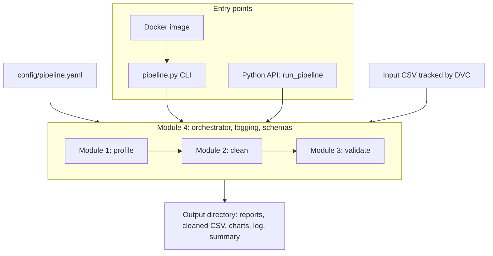
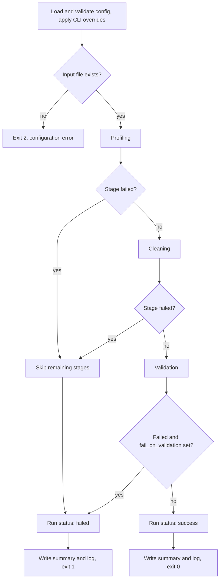

# Automated Data Quality & Validation System

A data gatekeeper for CSV datasets: it profiles the data, cleans it, validates the result with rules and machine-learning models, and reports whether it is fit to use. It runs from one command, one Python call or one container, and a final presentation with demo steps and results is in [docs/presentation.md](docs/presentation.md).

1. Module 1 – Data Profiling
2. Module 2 – Data Cleaning
3. Module 3 – Data Validation
4. Module 4 – Integration, orchestration and production engineering (CLI, config, logging, DVC, Docker, tests)

## Project structure

- [pipeline.py](pipeline.py) – command-line entry point (`run_pipeline.py` is a thin alias)
- [config/pipeline.yaml](config/pipeline.yaml) – default pipeline settings
- [module_1_profiling/profiler.py](module_1_profiling/profiler.py) – profiles the dataset and detects metadata issues
- [module_2_cleaning/cleaner.py](module_2_cleaning/cleaner.py) – cleans and standardizes the data
- [module_3_validation/validator.py](module_3_validation/validator.py) – validates the cleaned dataset (rules, anomaly detection, column classifier, error detection, drift, scoring, evaluation)
- [module_4_automation/](module_4_automation) – `config.py` (YAML loading and validation), `schemas.py` (input and output schemas), `orchestrator.py` (runs the stages), `logging_setup.py`
- [tests/](tests) – unit, CLI, integration, packaging and Docker tests
- [Dockerfile](Dockerfile), [requirements.txt](requirements.txt), [requirements-dev.txt](requirements-dev.txt) – packaging and dependencies

## Architecture



| Module | Input | Output |
|---|---|---|
| 1 Profile | raw CSV | `profiling_report.json`, three PNG charts |
| 2 Clean | raw CSV and the profiling report | `cleaned_data.csv`, `cleaning_log.json`, optional `transformed_features.csv` |
| 3 Validate | cleaned CSV, the profiling report, optional reference CSV | `validation_report.json`, `roc_curves.png` when there are enough rows |
| 4 Orchestrate | `PipelineConfig` (YAML plus CLI overrides) | `end_to_end_pipeline_summary.json` (`PipelineResult`), `pipeline.log` |

Modules are independent packages that exchange plain dictionaries and file paths, so each can be used on its own. Module 4 is the only one that knows about all three.

## Pipeline flow



- Every stage is timed and logged. Warnings are raised for suspicious, mixed-type and PII columns, duplicate rows, fuzzy duplicate candidates and high-severity validation findings.
- A stage that raises is recorded with its traceback in the log and its error in the summary; later stages are marked `skipped`. The summary is always written.
- `pipeline_ready` is true only when the run succeeded and validation passed (health score at or above `pass_threshold`). A failed validation fails the run only when `fail_on_validation` is set.

## Modules 1 and 2

Module 1 infers column and semantic types, flags mixed or inconsistent values, profiles missingness/cardinality/distributions/numeric outliers/correlations, checks suspicious formats and possible PII, and writes three PNG visualizations. Its JSON-safe report includes those findings and visualization paths.

Module 2 infers expected types, observed numeric ranges, and date formats; normalizes text and dates; removes exact duplicates; logs fuzzy name-match candidates without automatically deleting them; imputes numeric data using `mean`, `median`, `most_frequent`, `constant`, `knn`, `regression`, or `iterative`; imputes categorical values using the most frequent value; writes float columns rounded to 10 decimals so imputed means carry no floating-point noise; and records before/after quality scores in `cleaning_log.json`.

### Module 1 report structure

`profiling_report.json` contains dataset dimensions, `metadata` (inferred and semantic types, mixed-type columns, and potential PII), per-column profiles (missingness, cardinality, distributions, consistency counts, numeric statistics, and outliers), `profiling` (cardinality, distributions, and numeric correlation matrix), `quality_checks` (rule findings and suspicious columns), and `visualizations` (paths to the generated PNGs). Each column's expected type is the dominant observed type; minority values are counted as inconsistent rather than silently converted.

Public entry points:

```python
profile_dataset(file_path, output_dir=None) -> dict
clean_dataset(file_path, profile, output_dir, imputation_strategy="median",
			  fuzzy_threshold=0.92, transformations=None) -> Path
transform_features(df, scaling="standard", encode_categoricals=True,
				   extract_date_features=True) -> DataFrame
```

The cleaning report includes `schema_inference`, `actions`, `quality_score.before`, `quality_score.after`, `quality_score.delta`, and transformation output details. Fuzzy name matches are review candidates only; exact duplicate rows are removed automatically.

Feature transformations are optional and can be requested through the Python API:

```python
clean_dataset(
	input_file,
	profiling_report,
	output_dir,
	imputation_strategy="knn",
	transformations={
		"scaling": "standard",  # also "minmax" or "none"
		"encode_categoricals": True,
		"extract_date_features": True,
	},
)
```

The transformed feature matrix is written to `transformed_features.csv` only when transformations are requested.

## Module 3

`validate_dataset` reads the cleaned CSV (all values as text, so leading zeros survive) and writes `validation_report.json`:

- **Rules** (`rules.py`): email, phone and postcode formats, numeric ranges (age, percentages and amounts are inferred from column names), allowed values, and inconsistent category spelling or casing.
- **Anomaly detection** (`anomaly.py`): Isolation Forest, Local Outlier Factor and an MLP autoencoder over numeric columns. A row is anomalous when at least two detectors agree. Skipped below 10 rows.
- **Column classifier** (`nlp_classifier.py`): a character n-gram TF-IDF + logistic regression model trained at runtime on synthetic examples. It predicts each column's meaning, flags columns whose name disagrees with their values, and flags off-type values inside structured columns. Digit-only columns are ambiguous between numeric, postcode and identifier, so those pairs are never flagged.
- **Error detection** (`error_detection.py`): future or pre-1900 dates, end-before-start, duplicate identifiers and rows, empty columns, extreme values, placeholder or fake-looking values, and format outliers.
- **Drift** (`drift.py`): population stability index against a `reference` dataset (moderate at 0.1, high at 0.25). Without a reference the two row halves are compared for information only and raise no findings.
- **Scoring** (`scoring.py`): `error_severity` is the severity-weighted share of rows with an error, `anomaly_severity` is the average detector agreement, and column-level findings without row masks (drift, mislabeled or empty columns) subtract up to 30 points. `health_score = 100 - 0.6*error - 0.25*anomaly - structural`; the status is `pass` at or above `pass_threshold` (default 80).
- **Evaluation** (`evaluation.py`): precision, recall, F1, confusion matrix and ROC curves (JSON plus `roc_curves.png`). With `labels` the detectors and the combined validator are scored against real bad rows. Without labels, known anomalies are injected into the numeric features and the detectors are scored on finding them, which measures detector quality rather than data quality. Needs at least 30 rows.

```python
validate_dataset(file_path, profile=None, output_dir=None, reference=None, rules=None,
				 labels=None, contamination="auto", pass_threshold=80.0, seed=42) -> dict
```

`rules` accepts `numeric_ranges` (`{column: (min, max)}`), `allowed_values` (`{column: [...]}`) and `postcode_countries` (`us`, `uk`, `ca`, `in`). The report keeps `status`, `issues` and `passed_checks` for Module 4 and adds `scores`, `findings`, `column_classification`, `anomaly_detection`, `drift` and `evaluation`. The bundled 8-row sample (7 after cleaning) is too small for anomaly detection, drift and evaluation, so those sections report `skipped` there.

## Run locally

```bash
python -m pip install -r requirements.txt
python pipeline.py --input data/sample_customer_data.csv --output results/
```

All options are optional; without them the run uses [config/pipeline.yaml](config/pipeline.yaml). Logs go to stderr and `pipeline.log`; the result summary goes to stdout.

| Option | Effect |
|---|---|
| `--input CSV`, `--output DIR` | override `input.path` and `output.dir` |
| `--config YAML` | use another config file |
| `--reference CSV` | baseline dataset for drift detection |
| `--log-level LEVEL` | `DEBUG`, `INFO`, `WARNING` or `ERROR` |
| `--fail-on-validation` | treat a failed validation as a failed run |

Exit codes: `0` success, `1` pipeline failed, `2` configuration or input error.

This creates `profiling_report.json`, `cleaned_data.csv`, `cleaning_log.json`, `validation_report.json`, `pipeline.log` and `end_to_end_pipeline_summary.json` in the output directory. Module 1 also writes its heatmap and distribution PNG files under `profiling_visualizations/`, and Module 3 writes `roc_curves.png` under `validation_visualizations/` when the dataset is large enough to evaluate.

## Python API

Run from the project root (or with it on `PYTHONPATH`). `run_pipeline` is the same code path the CLI uses:

```python
from module_4_automation import load_config, parse_config, run_pipeline

config = load_config("config/pipeline.yaml")          # or build one from a dict:
config = parse_config({"input": {"path": "data/sample_customer_data.csv"},
                       "output": {"dir": "results"}, "logging": {"level": "ERROR"}})
result = run_pipeline(config)
print(result.status, result.pipeline_ready, result.validation_health_score)
```

Or call the modules directly, without the orchestrator:

```python
from module_1_profiling import profile_dataset
from module_2_cleaning import clean_dataset
from module_3_validation import validate_dataset

profile = profile_dataset("data/sample_customer_data.csv", "results/profiling_visualizations")
cleaned = clean_dataset("data/sample_customer_data.csv", profile, "results")   # returns the cleaned CSV path
report = validate_dataset(cleaned, profile=profile, output_dir="results/validation_visualizations")
print(report["status"], report["scores"]["health_score"])
```

`load_config`, `parse_config` and `run_pipeline` raise `ConfigError` for an invalid config or a missing input or reference file; stage failures are returned in the result instead.

**Input schema** (`PipelineConfig`, YAML keys): `input.path`, `output.dir`, `cleaning.{imputation_strategy, fuzzy_threshold, transformations}`, `validation.{pass_threshold, contamination, seed, reference, rules, fail_on_validation}`, `logging.{level, file}`. Unknown keys and out-of-range values are rejected.

**Output schema** (`PipelineResult`, written to `end_to_end_pipeline_summary.json`, `schema_version` 1.1): `run_id`, `status` (`success` or `failed`), `started_at`, `finished_at`, `duration_seconds`, `input_file`, `output_dir`, `cleaned_file`, `profiling_status`, `validation_status` (`pass`, `fail` or `not_run`), `validation_health_score`, `issues_found`, `pipeline_ready`, `error`, `input_data_version`, `config` (the settings used), `artifacts` (name to path) and `stages`. Each stage has `name`, `status` (`success`, `failed` or `skipped`), `duration_seconds`, `outputs`, `metrics` and `error`.

## Data versioning (DVC)

Only input data is versioned. `data/sample_customer_data.csv` is tracked by DVC: git stores the small pointer `data/sample_customer_data.csv.dvc` and DVC stores the file itself. Generated results in `outputs/` are not versioned, and each run records the md5 of its input in `input_data_version` of the summary so results can be traced to a data version.

DVC is development tooling, so it is not in `requirements.txt`; it is installed with `python -m pip install -r requirements-dev.txt`.

```bash
dvc add data/new_data.csv          # track a new or changed input file
git add data/new_data.csv.dvc data/.gitignore
dvc remote add -d storage <url>    # once; no remote is configured yet
dvc push                           # upload data to the remote
dvc pull                           # restore tracked data after a clone
dvc status                         # compare the working copy with the tracked version
```

## Docker

The image installs only `requirements.txt`, contains the pipeline code and default config but no data, and runs as a non-root user. Mount the dataset at `/data` and a writable folder at `/results`:

```bash
docker build -t dq-pipeline .
docker run --rm -v "$PWD/data:/data:ro" -v "$PWD/results:/results" dq-pipeline --input /data/sample_customer_data.csv --output /results
```

Without arguments the container processes `/data/input.csv` into `/results`. Any CLI option from the table above can be appended, and the exit codes are the same. On Linux, add `--user "$(id -u):$(id -g)"` if `/results` is not writable for the image's user (uid 1000). The DVC-tracked sample file must be fetched first (`dvc pull`).

Python code, tests, `data/` and `outputs/` are excluded from the image through `.dockerignore`; when you add a new top-level package, add a `COPY` line for it to the `Dockerfile` (a test fails if you forget).

## Testing

```bash
python -m pip install -r requirements-dev.txt
pytest                  # unit, CLI, integration and packaging tests (Docker tests excluded)
pytest -m integration   # only the end-to-end tests on generated data
pytest -m docker        # builds the image and runs it; skipped when no Docker daemon is running
```

- Unit tests per module: `test_module_1.py` to `test_module_4.py`; the CLI is covered by `test_cli.py`.
- `test_integration.py` runs the whole pipeline on a generated dataset with known defects (duplicates, missing and mixed-type values, messy emails and dates, planted outliers) and checks that each module's output is consumed correctly by the next, that the summary matches the individual reports, that runs are reproducible, and that drift against a reference is flagged.
- `test_packaging.py` checks that the `Dockerfile` copies every package, that `requirements.txt` covers every third-party import, and that the pipeline runs from a copy holding only the files the image contains.
- `test_docker.py` verifies the built image itself.

The demo steps and the results of real runs are in [docs/presentation.md](docs/presentation.md).
