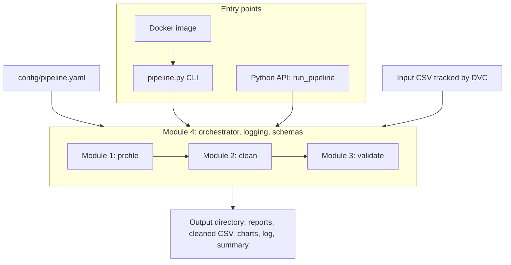

# Automated Data Quality & Validation System: final presentation

## 1. The problem

Raw data entering a company is messy: missing values, duplicates, wrong types, malformed emails and dates, impossible values, silent drift between deliveries. Insights built on it are unreliable. This system is a gatekeeper: every dataset is profiled, cleaned and validated automatically, and the result says whether it is fit to use.

## 2. Architecture



| Module | What it does | Output |
|---|---|---|
| 1 Profile | infers types and meaning, finds mixed types, PII and suspicious columns, profiles distributions, outliers and correlations | `profiling_report.json`, 3 charts |
| 2 Clean | normalizes text and dates, removes duplicates, imputes missing values (statistical or KNN, regression, iterative), scores quality before and after | `cleaned_data.csv`, `cleaning_log.json` |
| 3 Validate | rules, three anomaly detectors, a column-meaning classifier, error detection, drift, health score, detector evaluation | `validation_report.json`, `roc_curves.png` |
| 4 Automate | one configurable pipeline: CLI, YAML config, logging, DVC, Docker, tests | `end_to_end_pipeline_summary.json`, `pipeline.log` |

How a run flows, and what happens when a stage fails, is in the [pipeline flow](../README.md#pipeline-flow) diagram.

## 3. Working demo

Run everything from the project root. `demo/` and `results/` are git-ignored.

**Step 0: install and (once) fetch the DVC-tracked sample**

```bash
python -m pip install -r requirements-dev.txt
dvc pull        # only needed after a fresh clone, and once a remote is configured
```

**Step 1: the bundled sample (8 rows, one command)**

```bash
python pipeline.py --input data/sample_customer_data.csv --output results/sample
```

Prints the status, health score and the DVC version of the input, writes the reports, and logs warnings for the suspicious, mixed-type and PII columns it found.

**Step 2: a larger dataset with known defects**

The sample is too small for anomaly detection, drift and evaluation, so generate 252 rows with planted problems (12 duplicates, missing and mixed-type values, messy emails, bad dates, three extreme amounts at rows 10, 77 and 150) and a clean reference:

```bash
python -c "import os, sys; os.makedirs('demo', exist_ok=True); sys.path.insert(0, 'tests'); from test_integration import build_frame; build_frame().to_csv('demo/messy.csv', index=False); build_frame(seed=21, defects=False).to_csv('demo/reference.csv', index=False); build_frame(seed=11, amount_shift=150.0).to_csv('demo/shifted.csv', index=False)"
python pipeline.py --input demo/messy.csv --output results/messy
```

**Step 3: drift against a reference**

```bash
python pipeline.py --input demo/shifted.csv --reference demo/reference.csv --output results/shifted
```

**Step 4: as a container** (needs Docker; not run in the development environment, see section 6)

```bash
docker build -t dq-pipeline .
docker run --rm -v "$PWD/data:/data:ro" -v "$PWD/results:/results" dq-pipeline --input /data/sample_customer_data.csv --output /results
```

**Step 5: from Python**

```python
from module_4_automation import parse_config, run_pipeline
result = run_pipeline(parse_config({"input": {"path": "demo/messy.csv"}, "output": {"dir": "results/api"}}))
print(result.status, result.pipeline_ready, result.validation_health_score)
```

## 4. Results

All figures below come from real runs of the commands above.

### Bundled sample (8 rows, 7 after cleaning)

| Measure | Result |
|---|---|
| Quality score before, after | 87.92, 100.00 (+12.08) |
| Duplicates removed | 1 |
| Validation | pass, health score 98.29 |
| Findings | 1: `555-555-5555` in `phone` is a fake-looking placeholder |
| Column meanings | all 9 columns classified correctly (identifier, person name, email, numeric, text, date, phone) |
| Anomaly detection, drift, evaluation | skipped: fewer than 10, 40 and 30 rows respectively |
| Warnings logged | suspicious columns (`age`, `signup_date`), mixed types, PII (`name`, `email`, `phone`), 1 duplicate row |
| Input data version | DVC md5 `cf1529f23d9acb719f85e45d007aef72` recorded in the summary |

### Generated dataset with planted defects (252 rows, 240 after cleaning)

| Measure | Result |
|---|---|
| Quality score before, after | 97.23, 100.00 (+2.77) |
| Duplicates | 12 found by profiling, 12 removed by cleaning |
| Validation | pass, health score 99.31 (error severity 0.62, anomaly severity 1.25) |
| Findings | 2: the extreme-value rule and the multi-detector consensus both flag exactly the three planted rows 10, 77 and 150 |
| Column meanings | all 9 classified correctly |
| Run time | about 6.5 s end to end (profiling 2.5 s, cleaning 0.1 s, validation 3.8 s) |

### Anomaly detectors (evaluated by injecting 12 known anomalies into this data's numeric features)

| Detector | ROC AUC | Precision | Recall | True positive, false positive, true negative, false negative |
|---|---|---|---|---|
| Isolation Forest | 0.997 | 0.80 | 1.00 | 12, 3, 225, 0 |
| Local Outlier Factor | 0.996 | 0.40 | 1.00 | 12, 18, 210, 0 |
| Autoencoder | 0.991 | 1.00 | 0.17 | 2, 0, 228, 10 |

All three rank anomalies well (AUC above 0.99), but their default cut-offs differ: Local Outlier Factor over-flags, the autoencoder under-flags. That is why a row is called anomalous only when at least two detectors agree.

### Drift (`shifted.csv` against `reference.csv`)

| Column | PSI | Drift |
|---|---|---|
| `amount_spent` (mean shifted by 150) | 7.66 | high |
| `age`, `city`, `notes` | 0.015, 0.057, 0.000 | none |

The drift lowers the health score to 89.31 (a 10-point structural penalty) and raises a high-severity finding; it still passes the default threshold of 80. Use `--fail-on-validation` and a stricter `pass_threshold` to make drift stop a pipeline.

## 5. Production engineering

| Area | What was built |
|---|---|
| Interfaces | typed input (`PipelineConfig`) and output (`PipelineResult`, schema 1.1) schemas |
| Configuration | YAML config; unknown keys and bad values are rejected before anything runs |
| Logging | info, warning and error logs to the console and `pipeline.log`, with per-stage timings |
| Failure handling | a failed stage is logged with its traceback, later stages are skipped, the summary is still written |
| CLI | `python pipeline.py --input ... --output ...`; exit code 0 success, 1 pipeline failed, 2 configuration or input error |
| Data versioning | DVC tracks the input data only; each run records its input's md5 |
| Containerisation | non-root Docker image with data mounted at runtime; a test fails if a package is missing from the image or `requirements.txt` |
| Testing | 81 pytest tests (unit, CLI, end-to-end integration, packaging) plus 3 Docker tests that run on a machine with Docker |

## 6. Limitations and honest notes

- **Docker image not built here.** Docker is not installed in the development environment. The `Dockerfile` is covered by static checks and a clean-room test that runs the CLI from a copy holding only the image's files, but `pytest -m docker` has to be run once on a machine with Docker.
- **No DVC remote is configured.** `dvc push` and `dvc pull` need `dvc remote add -d storage <url>` first.
- **Evaluation without labels measures the detectors, not the data.** It injects known anomalies and scores how well each detector finds them. Pass `labels` to `validate_dataset` to score against real bad rows.
- **Small datasets skip statistical checks.** Below 10 rows no anomaly detection, below 40 rows no drift, below 30 rows no evaluation.
- **Fuzzy duplicates are reported, never deleted.** Similar-looking names need human review.
- **Memory.** The column classifier trains when validation starts (about 2.5 s and 70 MB peak). An earlier version kept every character n-gram (about 250 MB peak) and was reduced to the ones seen at least twice, with the same predictions on the test values.
- **Bugs found while preparing these results**, both fixed with regression tests: imputed means were written with floating-point noise (`196.42000000000002`), which the classifier read as a phone number and flagged; and the classifier model was larger than necessary.

## 7. Possible next steps

A CI workflow running `pytest`, a configured DVC remote, schema checks for incoming data against a declared contract, and labelled bad rows to evaluate the validator on real data.
